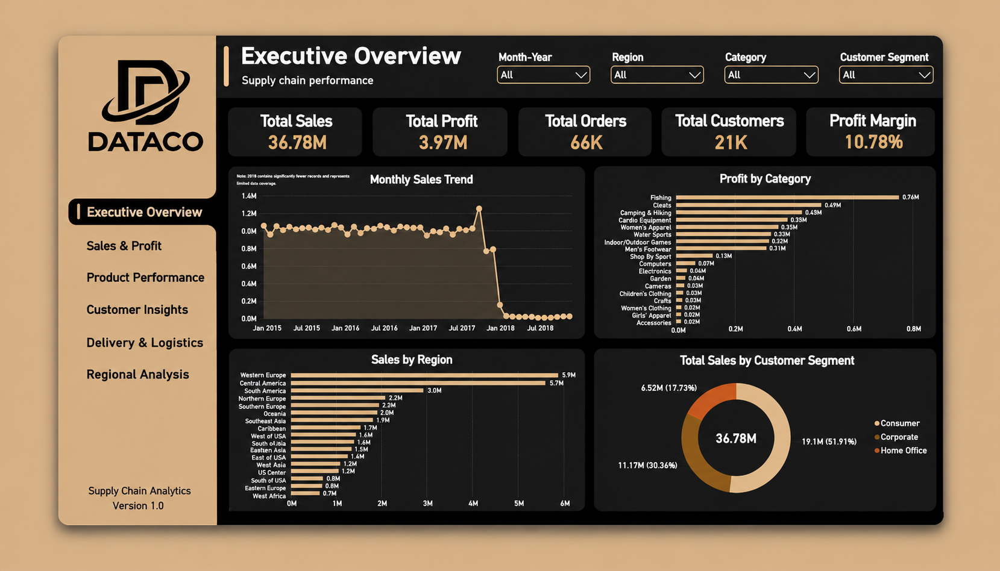

# Supply Chain & Inventory Analytics

An end-to-end data analytics project using the DataCo SMART SUPPLY CHAIN dataset to examine sales, profitability, customer behaviour, product performance, delivery efficiency and regional operations.

## Project Overview

This project transforms a raw supply chain dataset into an interactive Power BI report. Data preparation and analysis were carried out using SQL, Power Query and DAX, with MySQL used as the database layer.

The dashboard is organised into six analytical pages:

1. **Executive Overview** — headline sales, profit, orders, customers, profit margin and overall business performance.
2. **Sales & Profit** — monthly sales and profit trends, category performance, profit margins and regional results.
3. **Product Performance** — product-level sales and profit rankings, units sold by category, and product sales-versus-profit analysis.
4. **Customer Insights** — customer segment comparisons, average order value, customer distribution, top customers and monthly order trends.
5. **Delivery & Logistics** — delivery status mix, late-delivery rate by shipping mode, actual versus scheduled shipping days, and monthly late-delivery trends.
6. **Regional Analysis** — regional delivery-status breakdown, regional profitability matrix, profit margin by region and late-delivery rate by region.

## Business Objectives

- Monitor overall sales, profit and profitability.
- Identify high-performing and low-margin product categories.
- Understand sales contribution and purchasing behaviour across customer segments.
- Compare product demand, sales and profit.
- Examine delivery outcomes across shipping modes and regions.
- Identify regions that may need further operational investigation.

## Tech Stack

| Tool | Use |
|---|---|
| **MySQL** | Database storage and SQL-based data analysis |
| **SQL** | Data checks, transformations and business analysis |
| **Power BI** | Interactive dashboard and data visualisation |
| **Power Query** | Data cleaning and transformation before loading |
| **DAX** | Measures and calculated columns |
| **CSV** | Dataset input and cleaned data exchange |

## Dataset

**Dataset:** DataCo SMART SUPPLY CHAIN FOR BIG DATA ANALYSIS  
**Authors:** Fabian Constante, Fernando Silva and António Pereira  
**Year:** 2019  
**Repository:** Mendeley Data, Version 5  
**DOI:** [10.17632/8gx2fvg2k6.5](https://doi.org/10.17632/8gx2fvg2k6.5)  
**License:** CC BY 4.0

### Dataset Size

| Version | Rows | Columns |
|---|---:|---:|
| Original dataset | 180,519 | 53 |
| Cleaned project dataset | 180,519 | 45 |

The cleaned dataset is provided as `Dataset/DataCo_Cleaned.csv`. Three missing Customer Zipcode values were retained as null, and no duplicate rows were found in the cleaned dataset.

## Data Preparation & Analysis

- Loaded the cleaned dataset into MySQL.
- Used SQL to examine business performance, customer segments, regions, products, discounts and delivery outcomes.
- Connected Power BI to the MySQL database.
- Applied data type changes and transformations in Power Query.
- Created DAX measures for sales, profit, orders, customers, margins, customer metrics and delivery metrics.
- Created date and sorting columns to support chronological month-year analysis and custom delivery-status ordering.

The approved DAX documentation is available at [`Documentation/DAX_Measures.txt`](Documentation/DAX_Measures.txt).

## Key Findings

### Overall Business Performance

- **Total Sales:** 36.78M
- **Total Profit:** 3.97M
- **Total Orders:** 65,752
- **Total Customers:** 20,652
- **Profit Margin:** 10.78%

Monetary figures are shown in dataset currency units. The dataset currency code has not been verified, so the values are not labelled as USD.

### Customer Segments

| Segment | Sales | Share of Sales |
|---|---:|---:|
| Consumer | 19.10M | 51.91% |
| Corporate | 11.17M | 30.36% |
| Home Office | 6.52M | 17.73% |

The Consumer segment contributes the largest share of sales.

### Regional Sales

- Western Europe: 5.89M
- Central America: 5.67M

Together, Western Europe and Central America account for approximately 31.4% of total sales.

### Product & Category Performance

- The highest-sales product is **Field & Stream Sportsman 16 Gun Fire Safe**, with approximately 6.93M in sales.
- **Golf Bags & Carts** has the highest reported category profit margin at 17.46%.
- **Strength Training** has a reported profit margin of 0.61%.

### Delivery Performance

| Delivery Status | Order-item Records | Share |
|---|---:|---:|
| Late delivery | 98,977 | 54.83% |
| Advance shipping | 41,592 | 23.04% |
| Shipping on time | 32,196 | 17.84% |
| Shipping canceled | 7,754 | 4.30% |

Late-delivery rate by shipping mode:

| Shipping Mode | Late Delivery Rate |
|---|---:|
| First Class | 95.32% |
| Second Class | 76.63% |
| Same Day | 45.74% |
| Standard Class | 38.07% |

These comparisons are descriptive associations and do not establish that shipping mode causes delivery delays.

### Regional Delivery

- Central Africa has a listed late-delivery rate of 57.96%.
- Canada has the lowest listed regional late-delivery rate at 48.80%.
- The dashboard identifies at-risk regions using a late-delivery threshold above 55%. This is an analyst-defined threshold, not an external service-level agreement.

## Recommendations

1. **Investigate delivery delays:** Review late deliveries by carrier, shipping mode, region and order period before changing shipping policies.
2. **Prioritise regional reviews:** Investigate regions with higher late-delivery rates to identify operational bottlenecks.
3. **Review low-margin categories:** Examine pricing, discounting, product costs and fulfilment costs for categories with weak margins.
4. **Evaluate discount effectiveness:** Assess incremental profit, not only sales growth, when reviewing discount levels.
5. **Monitor regional balance:** Review sales alongside profit margin and delivery performance rather than relying on sales alone.

These are investigation priorities based on observed patterns; they are not confirmed root causes.

## Dashboard Pages

The Power BI report contains six pages:

- `Screenshots/Home_Page.png`
- `Screenshots/Executive_Overview.png`
- `Screenshots/Sales_and_Profit.png`
- `Screenshots/Product_Performance.png`
- `Screenshots/Customer_Insights.png`
- `Screenshots/Delivery_and_Logistics.png`
- `Screenshots/Regional_Analysis.png`

Once these screenshots are added to the repository, they can be displayed here. Example:

```markdown

```

## Repository Structure

```text
Supply-Chain-and-Inventory-Analytics/
│
├── Dashboard/
│   ├── Supply_Chain_Ops.pbix
│   └── Dashboard_PDF.pdf
│
├── Dataset/
│   ├── DataCo_Cleaned.csv
│   └── Dataset_Source.txt
│
├── Documentation/
│   ├── Project_Report.pdf
│   ├── Data_Dictionary.pdf
│   ├── DAX_Measures.txt
│   └── Key_Findings_and_Recommendations.pdf
│
├── Screenshots/
│   ├── Home_Page.png
│   ├── Executive_Overview.png
│   ├── Sales_and_Profit.png
│   ├── Product_Performance.png
│   ├── Customer_Insights.png
│   ├── Delivery_and_Logistics.png
│   └── Regional_Analysis.png
│
├── Business_Problems/
│   └── Business_Problems.pdf
│
├── SQL/
│   ├── Data_Cleaning.sql
│   ├── Business_Analysis.sql
│   └── SQL_Insights.sql
│
├── README.md
└── .gitignore
```

The structure above is the intended repository layout. Include only files that you have actually created and are ready to publish.

## How to Use

1. Clone or download this repository.
2. Open `Dashboard/Supply_Chain_Ops.pbix` using Power BI Desktop.
3. If prompted, configure the MySQL connection for your environment.
4. Ensure the required dataset and database table are available.
5. Refresh the report to load the data.
6. Use the report filters for Month-Year, Region, Category and Customer Segment to explore the analysis.

Connection credentials are not included in this repository. Do not commit passwords, private connection details or other secrets.

## Limitations & Interpretation Notes

- Delivery measures count order-item records, not distinct physical shipments.
- The original dataset contains 180,519 rows and 53 columns; the cleaned project dataset contains 180,519 rows and 45 columns.
- 2018 contains only 2,123 records, substantially fewer than 2015–2017. Treat 2018 as limited data coverage and avoid interpreting its lower totals as a business collapse.
- Three missing Customer Zipcode values were retained as null.
- The dataset currency code has not been verified.
- Differences by discount band, region or shipping mode are descriptive associations and do not prove causation.
- The `At-Risk Regions` measure uses an analyst-defined late-delivery threshold greater than 55%.

## Project Information

- **Project:** Supply Chain & Inventory Analytics
- **Year:** 2026
- **Status:** Power BI dashboard and supporting analysis prepared
- **GitHub / Live Link:** Add the repository URL after publishing

## Dataset Citation

Constante, F., Silva, F., & Pereira, A. (2019). *DataCo SMART SUPPLY CHAIN FOR BIG DATA ANALYSIS* (Version 5). Mendeley Data. https://doi.org/10.17632/8gx2fvg2k6.5

Dataset license: CC BY 4.0. Retain the source attribution and comply with the license when redistributing the dataset.
